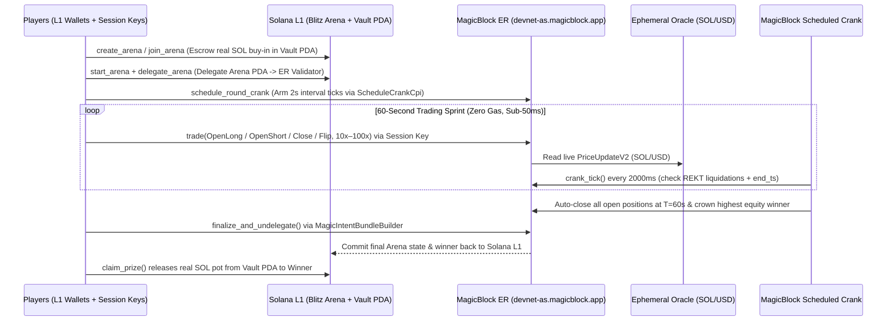

# ⚡ BLITZ ARENA — 60s PvP Micro-Trading Sprint on Solana

**Built for Solana Blitz v10 (Theme: Entertainment Finance)** — powered by **MagicBlock Ephemeral Rollups**, **MagicBlock Ephemeral Oracle (SOL/USD)**, and **MagicBlock Scheduled Cranks**.

> *Games are becoming markets, and markets are becoming entertainment.*
> Blitz Arena turns live Solana price action into a 60-second winner-takes-all PvP arcade sprint with **sub-50ms execution**, **zero gas fees**, **up to 100x leverage**, **hot-streak combos**, and **automated onchain crank liquidations & settlement**.

---

## 🎯 How It Works (L1 ↔ MagicBlock ER Lifecycle)



---

## 🧩 MagicBlock Primitives Integrated

| Primitive | Usage in Blitz Arena | Implementation |
| --- | --- | --- |
| **Ephemeral Rollups (`#[ephemeral]`, `#[delegate]`, `#[commit]`)** | Delegates the `Arena` PDA to `MAS1Dt9qreoRMQ14YQuhg8UTZMMzDdKhmkZMECCzk57` (`devnet-as.magicblock.app`) while keeping real SOL escrowed safely in the L1 `Vault` PDA. | `programs/blitz-arena/src/lib.rs` |
| **MagicBlock Automation (`ScheduleCrankCpi`)** | Schedules `crank_tick` every 2 seconds inside ER to enforce real-time liquidations (`REKT`) and auto-finalize the match at `T = duration_secs`. | `schedule_round_crank` & `crank_tick` |
| **MagicBlock Ephemeral Oracle (`PriceUpdateV2`)** | Reads sub-second **SOL/USD** (`ENYwebBThHzmzwPLAQvCucUTsjyfBSZdD9ViXksS4jPu`) inside every onchain trade and crank tick, and streams live ticks to the 60fps canvas chart via WebSocket. | `programs/blitz-arena/src/math.rs`, `app/src/lib/oracle.ts` |
| **Session-Key Zero-Popup UX** | Registers an ephemeral session pubkey per player on L1 join so players fire rapid `LONG / SHORT / CLOSE / FLIP` ER transactions with keyboard hotkeys (`W`, `S`, `Space`, `F`) and zero wallet popups while L1 prize claims stay locked to the main wallet. | `PlayerSlot.session_key` |

---

## 🚀 Quick Start (Frontend — Live MagicBlock Oracle Out of the Box)

```bash
cd app
npm install
npm run dev
```

Open `http://localhost:5173`. The app immediately connects to MagicBlock Asia Devnet (`wss://devnet-as.magicblock.app`) and streams live **SOL/USD** ticks from `ENYwebBThHzmzwPLAQvCucUTsjyfBSZdD9ViXksS4jPu`.

---

## 🛠️ Build & Deploy Anchor Program to Solana Devnet

### Option A — Automated GitHub Actions (Zero Local Rust/WSL Needed!)
1. Push this repository to a **public GitHub repo**.
2. Go to **GitHub Repo → Settings → Secrets and variables → Actions** and add:
   - `SOLANA_DEPLOYER_KEYPAIR`: JSON array of a Devnet wallet funded with ~3 Devnet SOL (from `https://faucet.solana.com`).
   - `PROGRAM_KEYPAIR` *(optional)*: JSON array for deterministic Program ID (`F3af5wwcApM79ZjGTXQs5UdGqQ9aEgkxUVYA255HZGao`).
3. Open **Actions → Build, Test & Deploy Blitz Arena → Run workflow** with `deploy_devnet = true`.
4. Copy the printed `DEPLOYED_PROGRAM_ID` into Vercel env var `VITE_BLITZ_PROGRAM_ID` (if changed) and deploy `app/` to Vercel!

### Option B — Linux / macOS / WSL / GitHub Codespaces
```bash
# Exact MagicBlock toolchain
agave-install init 3.1.9
rustup install 1.89.0
avm use 1.0.2

# Build, test, and deploy to Devnet
bash scripts/deploy-devnet.sh
```

---

## 📦 Devnet Configuration

* **Program ID:** `F3af5wwcApM79ZjGTXQs5UdGqQ9aEgkxUVYA255HZGao`
* **Base Layer RPC:** `https://rpc.magicblock.app/devnet`
* **ER Validator (Asia):** `MAS1Dt9qreoRMQ14YQuhg8UTZMMzDdKhmkZMECCzk57` (`https://devnet-as.magicblock.app`)
* **SOL/USD Ephemeral Oracle:** `ENYwebBThHzmzwPLAQvCucUTsjyfBSZdD9ViXksS4jPu`
* **Delegation Program:** `DELeGGvXpWV2fqJUhqcF5ZSYMS4JTLjteaAMARRSaeSh`
* **Magic Program:** `Magic11111111111111111111111111111111111111`
